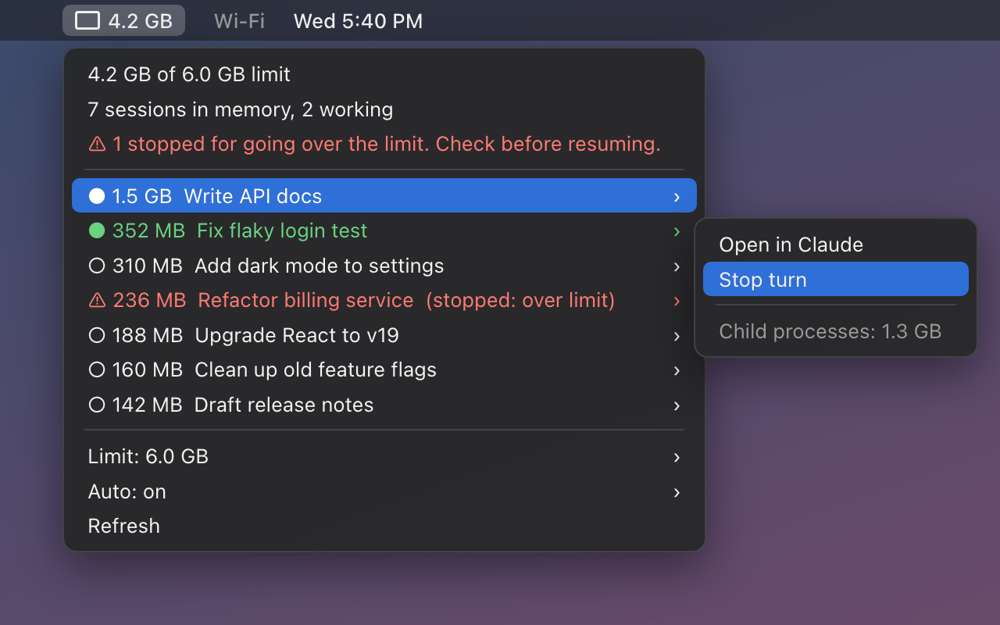

# Session RAM

 

*The panel inside a Claude session (left) and the macOS menu bar (right), shown with sample sessions.*

See how much RAM each Claude Code session in the Claude desktop app is using, which ones are working, and stop the ones that run away, on macOS and Windows.

- **Panel:** beside each Code session in the Claude desktop app.
- **Menu bar (macOS) or tray icon (Windows):** always visible, whichever session you're in. Optional.

Both show every session loaded in memory, largest first, with its RAM (including the lint, tsc and dev-server processes it started) and its status:

| Mark | Color | Meaning |
| --- | --- | --- |
| ● | green | **Working**: a turn is in progress. Has a **Stop turn** button. |
| ○ | white | **Idle**: loaded and waiting for you. Its RAM is the conversation it holds in memory. |
| ⚠ | red | **Stopped (over limit)**: Auto stopped its turn. Look into it before resuming; the flag clears once you resume it. |
| · | gray | **Unknown**: no session running the mod has reported in the last minute (see Troubleshooting). |

**Limit and Auto.** Set a RAM limit (default 6 GB) by typing a value like `8` or `8 GB`, or with the presets. Going over it warns you. With **Auto** on, while you're over the limit it stops the in-progress turn of the largest working session and flags it red, one session every 20 seconds at most. **Auto never archives or closes anything**, and it's off by default. The limit can't hard-cap RAM: it warns and, with Auto, stops turns.

**Panel on start.** The panel opens by itself when a session starts. If you use the menu bar or tray instead, switch off **Open panel when a session starts** in their menu; you can still open the panel with `/session-ram`.

## Install

### Step 1: the mod (everyone)

1. Open the Claude desktop app and any Code session.
2. Click **+** next to the prompt box, then **Plugins**.
3. Choose **Add marketplace** and enter `tjha/session-ram`.
4. Find **session-ram** in the list and choose **Add plugin**.
5. Quit Claude completely and reopen it, so every session loads the mod (each session loads it only when it starts):
   - macOS: press ⌘Q (closing the window isn't enough).
   - Windows: right-click the Claude icon by the clock and choose **Quit**.

**You should see** the **Session RAM** panel beside your Code session. If you close it, type `/session-ram` to bring it back.

Prefer a terminal? These two commands do steps 2–4:

```bash
claude plugin marketplace add tjha/session-ram
claude plugin install session-ram@session-ram
```

### Step 2 (optional): menu bar on macOS

Needs [Homebrew](https://brew.sh). Run these in Terminal, one after another:

1. Install [SwiftBar](https://swiftbar.app), the free app that shows the menu:

   ```bash
   brew install --cask swiftbar
   ```

2. Download the menu-bar script:

   ```bash
   mkdir -p ~/SwiftBarPlugins && curl -fsSL -o ~/SwiftBarPlugins/session-ram.15s.py https://raw.githubusercontent.com/tjha/session-ram/main/menubar/session-ram.15s.py && chmod +x ~/SwiftBarPlugins/session-ram.15s.py
   ```

3. Point SwiftBar at it and start SwiftBar:

   ```bash
   defaults write com.ameba.SwiftBar PluginDirectory -string "$HOME/SwiftBarPlugins" && open -a SwiftBar
   ```

4. To start it when you log in:

   ```bash
   osascript -e 'tell application "System Events" to make login item at end with properties {path:"/Applications/SwiftBar.app", hidden:true}'
   ```

**You should see** a memory-chip icon with your total RAM in the menu bar. Click it for the list. Each session's submenu has **Open in Claude** and, while it's working, **Stop turn**. **Limit** has **Set limit…** and presets from 4 to 16 GB. If SwiftBar shows a welcome window the first time, click through it.

### Step 2 (optional): tray icon on Windows

Uses the PowerShell that comes with Windows. Open **PowerShell** (not as administrator) and run:

1. Download the tray script and start it:

   ```powershell
   $dir = "$env:USERPROFILE\SessionRam"; New-Item -ItemType Directory -Force $dir | Out-Null
   Invoke-WebRequest https://raw.githubusercontent.com/tjha/session-ram/main/tray/session-ram-tray.ps1 -OutFile "$dir\session-ram-tray.ps1"
   Start-Process powershell -ArgumentList '-NoProfile','-WindowStyle','Hidden','-ExecutionPolicy','Bypass','-File',"$dir\session-ram-tray.ps1"
   ```

2. To start it when you sign in to Windows:

   ```powershell
   $s = (New-Object -ComObject WScript.Shell).CreateShortcut("$([Environment]::GetFolderPath('Startup'))\Session RAM.lnk")
   $s.TargetPath = 'powershell.exe'; $s.Arguments = "-NoProfile -WindowStyle Hidden -ExecutionPolicy Bypass -File `"$env:USERPROFILE\SessionRam\session-ram-tray.ps1`""; $s.Save()
   ```

**You should see** a new icon by the clock (it may be under the **^** arrow; drag it out to keep it visible). Hover for the total; click it for the same list and controls as the macOS menu. **Exit** is at the bottom of the menu.

The tray script has passed its self-test under PowerShell 7, but hasn't been run on Windows yet. If it misbehaves, please open an issue.

## Troubleshooting

- **"Working/idle unknown", or no Stop turn buttons.** The menu bar and tray measure RAM on their own, but working/idle status, Stop turn and Auto come from the mod running inside Claude sessions. At least one session started *after* you installed the mod must be open. Quit and reopen Claude (Step 1, item 5), or open a new Code session.
- **Stop turn does nothing for one session.** A session can't stop its own turn. If that session is the only one running the mod, open another session.
- **No panel.** Type `/session-ram` in the session.
- **No menu-bar icon.** Check that `~/SwiftBarPlugins/session-ram.15s.py` exists and is executable (step 2 sets this), and that SwiftBar is running.

## How it works

- Every session with the mod measures all sessions every 15 seconds: one process listing (`ps` on macOS, PowerShell `Get-CimInstance Win32_Process` on Windows) and one status lookup per session through the app's own session tools.
- Shared files in `~/.claude` (Windows: `%USERPROFILE%\.claude`) connect the panel, the menu bar and the tray:
  - `session-ram-settings.json`: the limit and the Auto switch.
  - `session-ram-status.json`: the latest snapshot, which the menu bar and tray read.
  - `session-ram-stopped.json`: the sessions Auto stopped.
  - `session-ram-requests.json`: Stop turn requests from the menu bar or tray. Any session running the mod carries them out within about 3 seconds.
- Session names come from the app's files under `~/Library/Application Support/Claude/claude-code-sessions` (macOS) or `%APPDATA%\Claude\claude-code-sessions` (Windows).
- On Windows, a session started fresh since the app opened shows as "Unknown session" until it's resumed, because Windows doesn't let one process read another's environment, where its ID lives.
- The panel's **Archive** button is the only thing that archives, and only when you press it.
