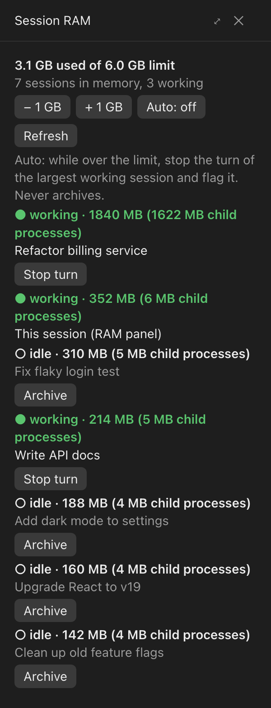

# Session RAM



*The panel, shown with sample sessions.*

A Claude Code mod for the Claude desktop app on macOS and Windows. It opens a **Session RAM** panel beside each Code session and shows:

- every Claude Code session currently loaded in memory, largest first
- how much RAM each one uses, counting its child processes (lint, tsc, dev servers)
- whether it is **working** or **idle**
- a **Stop turn** button for working sessions and an **Archive** button for idle ones

It also has a RAM limit (default 6 GB). Type an exact value such as `8` or `8 GB` in the panel, or use **− 1 GB / + 1 GB**. Going over the limit shows a toast. With **Auto** on, while usage is over the limit it stops the in-progress turn of the largest working session (ending its lint, tsc and other child processes) and flags it in red as **⚠ stopped (over limit)**, so you can look into it before resuming or starting new sessions. The flag clears once you resume that session. Auto never archives anything, and it's off by default.

The mod cannot hard-cap a process's RAM, so the limit is a warning plus optional archiving, not a hard cap.

## Install

At the prompt of a terminal session:

```
/plugin marketplace add tjha/session-ram
/plugin install session-ram@session-ram
```

From a shell:

```bash
claude plugin marketplace add tjha/session-ram
claude plugin install session-ram@session-ram
```

In the desktop app, where `/plugin` does not run: click + next to the prompt box, then Plugins, Add marketplace with `tjha/session-ram`, then Add plugin.

Installed at the user scope, the mod loads in every Code session the desktop app starts. Type `/session-ram` to reopen the panel after closing it.

## Menu bar (macOS)

`menubar/session-ram.15s.py` shows the same information in the macOS menu bar, whichever session you're in: total RAM (red when over the limit or when Auto stopped something), and each loaded session with its RAM and status. Each session opens in Claude from its submenu, and a working one has **Stop turn**. The menu also sets the limit (type a value with **Set limit…**, or pick 4–16 GB) and the Auto switch. It needs [SwiftBar](https://swiftbar.app):

```bash
brew install --cask swiftbar
```

```bash
mkdir -p ~/SwiftBarPlugins && curl -fsSL -o ~/SwiftBarPlugins/session-ram.15s.py https://raw.githubusercontent.com/tjha/session-ram/main/menubar/session-ram.15s.py && chmod +x ~/SwiftBarPlugins/session-ram.15s.py
```

Then open SwiftBar and choose `~/SwiftBarPlugins` as its plugin folder.

## Tray icon (Windows)

`tray/session-ram-tray.ps1` is the same thing as an icon in the Windows notification area, by the clock. It needs only the Windows PowerShell that comes with Windows. Click the icon for the session list, the limit and Auto. Run this in PowerShell:

```powershell
$dir = "$env:USERPROFILE\SessionRam"; New-Item -ItemType Directory -Force $dir | Out-Null
Invoke-WebRequest https://raw.githubusercontent.com/tjha/session-ram/main/tray/session-ram-tray.ps1 -OutFile "$dir\session-ram-tray.ps1"
Start-Process powershell -ArgumentList '-NoProfile','-WindowStyle','Hidden','-ExecutionPolicy','Bypass','-File',"$dir\session-ram-tray.ps1"
```

To start it when you sign in to Windows:

```powershell
$s = (New-Object -ComObject WScript.Shell).CreateShortcut("$([Environment]::GetFolderPath('Startup'))\Session RAM.lnk")
$s.TargetPath = 'powershell.exe'; $s.Arguments = "-NoProfile -WindowStyle Hidden -ExecutionPolicy Bypass -File `"$env:USERPROFILE\SessionRam\session-ram-tray.ps1`""; $s.Save()
```

The tray script is checked with its self-test (`-SelfTest`) under PowerShell 7 on macOS, not yet on Windows.

## How the menu bar and tray talk to Claude

Both measure RAM themselves. Working/idle status, Auto and **Stop turn** need at least one Claude session running the mod: the menu bar and tray can't reach the app's session controls, so they leave a stop request in `~/.claude/session-ram-requests.json` and the mod in any running session carries it out within about 3 seconds. A session can't stop its own turn, so stopping the only session running the mod needs another one open.

## Notes

- Refreshes every 15 seconds. Each session with the mod runs its own refresh: one process listing (`ps` on macOS, a PowerShell `Get-CimInstance Win32_Process` query on Windows) plus one lookup per loaded session.
- Archiving a session stops its process and, by default, removes its worktree; the app keeps a worktree with uncommitted changes. Archived sessions can be restored from the Archived list.
- The limit and the Auto setting are shared by all sessions, the menu bar and the tray, through `~/.claude/session-ram-settings.json`. The mod also writes its latest snapshot to `~/.claude/session-ram-status.json` and the sessions Auto stopped to `~/.claude/session-ram-stopped.json`.
- Session names come from the desktop app's files under `~/Library/Application Support/Claude/claude-code-sessions` (macOS) or `%APPDATA%\Claude\claude-code-sessions` (Windows); working/idle status and the buttons use the app's own session tools, so they work only inside the desktop app.
- Windows support is checked with sample data only, not yet on a Windows machine. If the panel says "Could not measure" there, please open an issue with that line.
